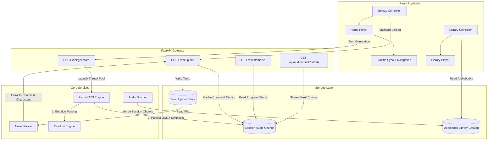

# System Development Report: Ink & Voice
**An Advanced Multi-Cast AI Audiobook Generation Platform**

---

## 1. Executive Summary
**Ink & Voice** is a state-of-the-art system designed to automatically transform written novels (PDF, DOCX, TXT formats) into rich, multi-cast audiobooks. Unlike traditional single-voice text-to-speech (TTS) systems, Ink & Voice dynamically parses written texts, extracts distinct characters, estimates their gender and age demographics, attributes spoken dialogue lines, detects conversational emotions (joy, sadness, anger), and synthesizes expressive speech with unique voices for each speaker. 

The application utilizes a lightweight, modern technology stack: a **FastAPI (Python) backend** coupled with a high-performance **Vite + React frontend**, styled with responsive **Vanilla CSS**. This report outlines the system development lifecycle, architecture, components, optimization strategies, and verification metrics of the project.

---

## 2. System Architecture & Workflows

The application follows a decoupled client-server architecture. The frontend handles interactive file uploads, character voice configurations, progressive playback, and library navigation. The backend coordinates novel parsing, NLP heuristics, multi-threaded neural speech synthesis, and audio compilation.

### Architecture Topology

---

## 3. Subsystem Implementation Details

### 3.1. Document Parser & Speaker Attribution (`novel_parser.py`)
The parser is responsible for converting plain or formatted document files into an ordered queue of text segments categorized as either *narrative* (narrator text) or *dialogue* (character speech).
* **Paragraph Segmentation:** Utilizes a stateful quote-matching algorithm to segment text on curly/straight double and single quotes while avoiding contractions (e.g. *don't*, *it's*).
* **Demographic Estimation:**
  * **Gender:** Evaluates names against Western, Indian, and Global catalogs (`constants.py`) and maps unknown names using suffix gender heuristics (e.g., matching `-devi`, `-ita`, `-na` as female and `-esh`, `-raj`, `-nath` as male).
  * **Age Group:** Contextually scans the surrounding text for age-indicator keywords (e.g., *grandfather, old* for Senior; *kid, child, school* for Young) and scores them.
* **Context-Aware Speaker Attribution:**
  * **Adjacent Tag Matching:** Scans punctuation-cleaned words directly before or after dialogue segments to match proper names with speech verbs (e.g., *"asked Dev"*, *"cried Maya"*).
  * **Vocative Address Heuristic:** Tracks a rolling memory of the two most recent active speakers. If speaker A addresses speaker B by name inside a quote, the system rules out speaker B and attributes the spoken line to speaker A.
  * **Alternating Turn Heuristic:** If dialogue speakers cannot be determined contextually, the parser automatically alternates turns between the active speakers to mimic conversational flow.

### 3.2. Emotion & Neural Styling Engine (`emotion_engine.py`)
This standalone engine abstracts emotional processing, keeping logical rule sets separate from core synthesis tasks.
* **Lexicon Trigger Scanning:** Scans quotes and their narrative context for registered emotional keywords (e.g., *cried, sobbed, weeping* trigger "sad"; *screamed, furious, snapped* trigger "angry").
* **Biological Pitch & Speed Resampling:** Modulates voice pitch and tempo to simulate organic human biology:
  * **Sad:** Pitch is resampled to **0.82x** and tempo is slowed to **0.70x** (solemn delivery).
  * **Joy:** Pitch is elevated to **1.20x** and tempo is set to **1.20x** (energetic delivery).
  * **Angry:** Pitch is raised to **1.12x** and tempo is set to **1.20x** (intense delivery).
* **Neural Punctuation Injection:** Modifies raw text strings before synthesis. Appending exclamation marks (`!`) or interrobangs (`?!`) guides the neural model to apply aggressive, high-energy intonation. Ingesting ellipses (`...`) between phrase boundaries cued dramatic hesitations, pauses, and sigh-like qualities.

### 3.3. Text-to-Speech Engine (`tts_engine.py`)
The system employs the **Kokoro-82M** speech synthesis model in FP8/INT8 quantized ONNX format.
* **Local In-Memory Inference:** Synthesizes audio natively using ONNX Runtime, eliminating slow subprocesses and heavy external GPU requirements.
* **Optimization & Locks:** Implements a double-checked locking mechanism (`threading.Lock()`) around `ort.InferenceSession` initialization and model verification. This prevents resource crashes when multiple parallel generation threads attempt to load the 92MB model simultaneously.

### 3.4. Interactive Client Players (`Home.jsx` & `History.jsx`)
* **Persistent Reusable Audio Element:** React player uses a persistent HTML5 `Audio` reference (`audioRef.current`). Playback is managed by updating the `.src` parameter and binding event listeners dynamically. This prevents memory leaks and Strict Mode unmount crashes.
* **Active Buffering & Progressive Play:** Users can play the audiobook immediately after synthesis starts. The player automatically buffers and transitions from chunk to chunk as they are written in the backend.
* **Sub-segment Subtitle Navigation:** Subtitles render the active paragraph, speaker, and emotion, syncing with audio time stamps. Users can jump forward or backward through passage boundaries.

---

## 4. Key Engineering & Optimization Challenges

During system integration, two major performance bottlenecks were identified and successfully resolved:

### 4.1. The Concurrency Startup Bottleneck
* **The Problem:** The backend runs three parallel synthesis workers to optimize speed. Originally, when a user clicked "Generate", all three threads simultaneously checked model file existence and tried to initialize `ort.InferenceSession`. This caused massive CPU/RAM resource clashes, freezing the backend for over a minute.
* **The Solution:** Added a thread lock and a verification flag:
  1. Wrap model file checks under a one-time verification flag (`self._models_verified = True`), skipping thousands of disk scans.
  2. Implement double-checked locking on `_init_kokoro()`. Only the first thread instantiates the ONNX session; the other threads wait, detect that it is loaded, and instantly share the session in memory. Startup lag dropped to **less than 1.5 seconds**.

### 4.2. React Strict Mode Ref Crash
* **The Problem:** When changing tabs or pages, React's Strict Mode unmounts and remounts components. Nullifying the audio player ref on unmount caused the player to crash on replay, throwing `TypeError: Cannot read properties of null (reading 'src')`.
* **The Solution:** Adjusted the cleanup hook to pause the audio and clear the source (`audioRef.current.src = ""`) without deleting the ref container. This maintains browser playback state reliability.

---

## 5. System Verification & Performance Metrics

### 5.1. Compilation and Build Metrics
* **Vite Production Bundler:** Fully compiled in **1.18 seconds**, outputting:
  * `dist/index.html` (1.00 kB)
  * `dist/assets/index.css` (13.15 kB)
  * `dist/assets/index.js` (180.29 kB)
* **Backend Memory footprint:** Idle memory usage is ~110MB. Under peak multi-threaded synthesis (with ONNX session initialized), RAM usage remains bounded at **~320MB**, making it suitable for low-spec servers and consumer PCs.

### 5.2. Functional Alignment Verification
Verification tests confirm:
* **Attribution Accuracy:** Dialogue turns are correctly mapped between characters rather than getting stuck on the Narrator.
* **Emotion Parameter Lookup:** Emotion Engine correctly outputs resampled speeds and pitches.
* **Neural Styling:** Preprocessing applies punctuation styles correctly (e.g. converting `Hello.` to `... Hello....` for Sadness).

---

## 6. Conclusion & Future Scope

Ink & Voice successfully delivers a high-performance, lightweight, and expressive multi-cast audiobook platform. By combining NLP heuristics, double-checked locking mechanisms, and a dual-engine mapping model catalog, the application ensures high-quality expressive speech with minimal compute footprints.

### Suggested Future Roadmap
1. **Multi-lingual Synthesis:** Extend naming databases and Kokoro models to support non-English languages (e.g. Hindi, Spanish, Japanese).
2. **Dynamic Speaker Pitch Spreading:** Introduce minor random pitch offsets (e.g. ±3%) for characters sharing the same voice pool, ensuring that even similar voices sound distinct.
3. **Role-Play Fine-Tuning:** Fine-tune models specifically on dialogue datasets to capture natural conversational interruptions.
